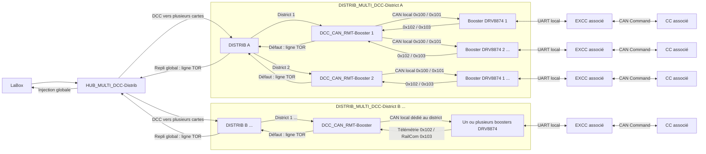
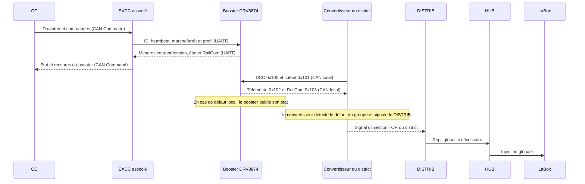

# CAN_DCC_RMT-Booster_DRV8874

Firmware de la carte booster de voie CFC basée sur ESP32 et DRV8874. Elle reçoit le DCC du convertisseur de son district sur un CAN local, régénère le signal pour la voie et échange les commandes et mesures détaillées avec son EXCC associé par UART.

## Place dans l’installation

Chaque sortie de district du `DISTRIB_MULTI_DCC-District` alimente un `DCC_CAN_RMT-Booster` dédié. Ce convertisseur forme le CAN DCC local du district avec un ou plusieurs boosters DRV8874.



Le CAN DCC local est distinct du CAN Command de l’EXCC et du CC. L’UART relie directement un booster à son EXCC. Le booster n’envoie pas sa télémétrie détaillée au DISTRIB : il envoie celle-ci à l’EXCC par UART. Sur le CAN DCC, il publie aussi une télémétrie compacte, notamment utilisée par le convertisseur pour surveiller les boosters de son groupe. Le convertisseur signale le défaut au DISTRIB par la ligne TOR prévue pour le district.

Le booster ne coupe pas sa sortie en réaction à la télémétrie d’un autre booster. Sa sortie dépend de son autorisation locale reçue de l’EXCC, de la présence de son identité, de la réception DCC et de ses protections électriques locales.

## Cycle de fonctionnement



## Interfaces et trames

### CAN DCC local

TWAI natif de l’ESP32, configuré à **500 kbit/s**.

| ID CAN | Sens | Données et rôle |
|---|---|---|
| `0x100` | Convertisseur → booster | Bloc de bits DCC : `data[0]` indique le nombre de bits; les nibbles suivants encodent bit et phase. Le booster place les bits en FIFO puis les régénère par RMT. |
| `0x101` | Convertisseur → booster | Début/fin de cutout RailCom; le booster passe le DRV8874 en freinage pendant la capture. |
| `0x102` | Booster → convertisseur et pairs du segment | `{ID canton, TYPE=1, courant/10, tension/100, état}`; périodicité d’une seconde après attribution d’un ID. Le booster n’utilise pas les `0x102` reçus pour commander sa sortie. |
| `0x103` | Booster → CAN local | Adresse RailCom détectée, deux octets little-endian. |

États télémétriques : `0=OK`, `1=FAULT`, `2=OVERHEAT`, `3=OFF`, `4=RETRY` (réservé).

### UART vers l’EXCC associé

Liaison point à point à **460800 bauds, 8N1**, UART1 sur le booster. Les deux firmwares utilisent la version de protocole `2` et des trames avec CRC-16/CCITT-FALSE.

```text
A5 5A | version:u8 | type:u8 | séquence:u16 LE | longueur:u8 | payload | CRC:u16 LE
```

| Type | Sens | Fonction |
|---|---|---|
| `0x01` | EXCC → booster | Heartbeat périodique (100 ms). |
| `0x02` | EXCC → booster | Autorisation puissance `OFF/ON`. |
| `0x03` | EXCC → booster | Profil de voie `N/HO`. |
| `0x04` | Booster → EXCC | Accusé de réception d’une commande. |
| `0x05` | EXCC → booster | Identité du canton `0..252`, ou retrait `0xFF`. |
| `0x10` | Booster → EXCC | Échantillon périodique : courant, tension, état et indicateurs de validité. |
| `0x11` | Booster → EXCC | Événement RailCom. |

Le booster échantillonne ses mesures à environ **1 kHz**. L’EXCC reçoit ces données par UART, les utilise pour la supervision et l’occupation du canton, puis transmet l’information au CC par son CAN Command.

## Autorisation et protections locales

- Au démarrage, l’identité du canton n’est pas attribuée et la sortie est désactivée.
- L’EXCC relaie l’identité attribuée par le CC. Elle est conservée uniquement en RAM; `0xFF` signifie non attribuée.
- Une commande ON n’est acceptée qu’avec un ID attribué. Les commandes de marche et d’identité nécessitent un heartbeat UART valide.
- Après **250 ms** sans heartbeat valide, le booster désactive la sortie et efface l’identité reçue.
- Après **500 ms** sans bloc DCC valide (`0x100`), le booster passe à OFF.
- Les seuils logiciels actuels sont **2 000 mA** de courant maximum et **9 000 mV** de tension minimum.
- Le traitement d’un défaut distant reçu en `0x102` a été supprimé : un autre booster ne peut pas commander la coupure de cette sortie.
- Le cutout global du `0x101` reste traité selon `CFG_ENABLE_GLOBAL_CUTOUT`.

## Brochage

| Fonction | GPIO | Détail |
|---|---:|---|
| CAN TX / RX | 5 / 4 | TWAI natif, CAN DCC local |
| UART TX / RX vers EXCC | 17 / 16 | UART1; TX/RX croisés, logique 3,3 V |
| DRV8874 IN1 / IN2 | 32 / 33 | RMT canal 5; IN2 reçoit le signal inversé par la matrice GPIO |
| DRV8874 nSLEEP | 27 | Niveau haut actif; PMODE doit être strapé en mode PWM |
| Mesure IPROPI | 34 | ADC courant, entrée uniquement |
| Mesure VRAIL | 35 | ADC tension via pont diviseur 68 kΩ / 10 kΩ |
| Entrée RailCom isolée | 36 | RX UART2, entrée uniquement |
| WS2812 | 26 | Bandeau de 3 LEDs, canal RMT 7 |
| Digipot SDA / SCL | 21 / 22 | MCP4551/4561 |

Pour l’UART, relier TX du booster à RX de l’EXCC, RX du booster à TX de l’EXCC, et relier les masses. Ce lien est séparé du CAN DCC et du port USB de diagnostic.

## Configuration et compilation

Les broches sont définies dans [`src/Pins.h`](src/Pins.h), les paramètres dans [`src/Config.h`](src/Config.h), et la cible PlatformIO dans [`platformio.ini`](platformio.ini). Dépendances : `CanUniversal` 3.1.1 et `Ws2812Universal` 1.1.0.

```powershell
pio run
pio run -t upload
pio device monitor -b 115200
```

Le firmware de l’EXCC associé doit utiliser le même protocole UART version 2. L’ID du canton n’est pas une constante de compilation : le CC l’attribue via l’EXCC.

## LEDs d’état

| LED | Signification |
|---|---|
| 1 | Activité/présence récente des blocs DCC; rouge clignotant en absence de DCC. |
| 2 | État de la sortie : vert actif, rouge défaut, éteinte hors tension. |
| 3 | Activité CAN récente; elle ne confirme pas à elle seule le bon fonctionnement de toutes les cartes du segment. |

## Fichiers principaux

| Fichier | Rôle |
|---|---|
| `BoosterCore.*` | Sécurité locale, état, flux DCC et pilotage du driver. |
| `BoosterUartLink.*`, `UartProtocol.h` | Commandes, heartbeat, ID, mesures et RailCom vers/depuis l’EXCC. |
| `CanBooster.*`, `BoosterCanConfig.h` | Initialisation et réception/émission sur le CAN DCC local. |
| `DccCanRx.*` | Décodage des blocs `0x100`, cutouts `0x101` et watchdog DCC. |
| `Telemetry.*` | Émission de la télémétrie `0x102` et de l’adresse RailCom `0x103`. |
| `DccRegen.*`, `Drv8874.*` | Régénération DCC par RMT et commande du DRV8874. |
| `RailCom.*` | Capture RailCom pendant le cutout. |
| `TensionControl.*` | Réglage du profil N/HO via digipot I2C. |
| `StatusLeds.*` | Affichage des états sur les trois WS2812. |

## État de validation

La compilation du firmware a été confirmée sans erreur. Cela valide la construction logicielle, pas à lui seul le câblage CAN/UART, les seuils analogiques, la régénération du signal DCC ou le comportement RailCom sur le matériel réel.
